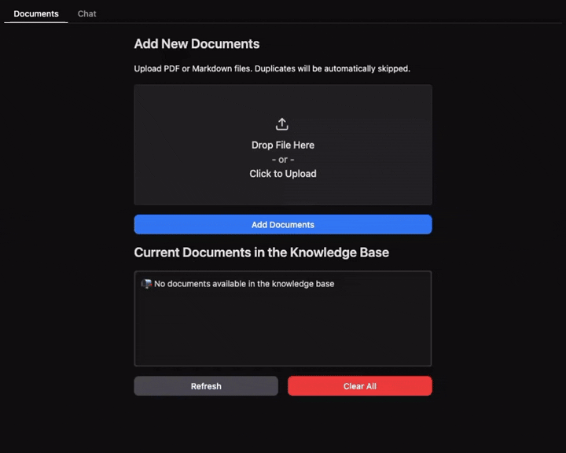
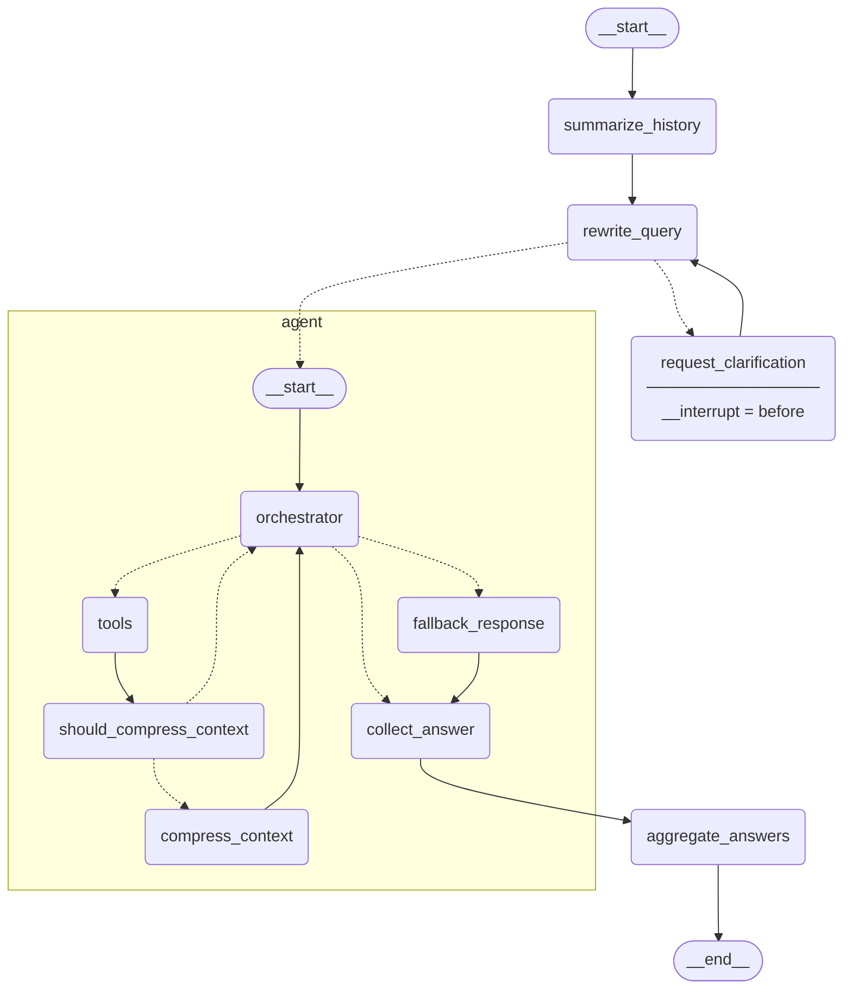

<p align="center">
  
</p>

<h1 align="center">Agentic RAG for Dummies</h1>

<p align="center">
  <strong>Build a modular Agentic RAG system with LangGraph, conversation memory, and human-in-the-loop query clarification</strong>
</p>

<p align="center">
  <a href="#overview">Overview</a> •
  <a href="#how-it-works">How It Works</a> •
  <a href="#llm-provider-configuration">LLM Providers</a> •
  <a href="#implementation">Implementation</a> •
  <a href="#installation--usage">Installation & Usage</a> •
  <a href="#troubleshooting">Troubleshooting</a>
</p>

<p align="center">
  
  
  
  <a href="https://github.com/von-development/awesome-langgraph">
    
  </a>
</p>

<p align="center">
  
  
  
  
</p>

<p align="center">
  <a href="https://colab.research.google.com/github/GiovanniPasq/agentic-rag-for-dummies/blob/main/notebooks/agentic_rag.ipynb">
    
  </a>
</p>

<p align="center">
  
</p>

<p align="center">
  <strong>If you like this project, a star ⭐️ would mean a lot :)</strong><br>
</p>

## Overview

This repository demonstrates how to build an **Agentic RAG (Retrieval-Augmented Generation)** system using LangGraph with minimal code. Most RAG tutorials show basic concepts but lack guidance on building modular, agent-driven systems — this project bridges that gap by providing **both learning materials and an extensible architecture**.

### What's inside

| Feature | Description |
|---|---|
| 🗂️ **Hierarchical Indexing** | Search small chunks for precision, retrieve large Parent chunks for context |
| 🧠 **Conversation Memory** | Maintains context across questions for natural dialogue |
| ❓ **Query Clarification** | Rewrites ambiguous queries or pauses to ask the user for details |
| 🤖 **Agent Orchestration** | LangGraph coordinates the full retrieval and reasoning workflow |
| 🔀 **Multi-Agent Map-Reduce** | Decomposes complex queries into parallel sub-queries |
| ✅ **Self-Correction** | Re-queries automatically if initial results are insufficient |
| 🗜️ **Context Compression** | Keeps working memory lean across long retrieval loops |
| 🔍 **Observability** | Track LLM calls, tool usage, and graph execution with Langfuse |
| 📊 **Evaluation** | Evaluate retrieval and answer quality with RAGAS metrics |

### 🎯 Two Ways to Use This Repo

**1️⃣ Learning Path: Interactive Notebook**

Step-by-step tutorial perfect for understanding core concepts. Start here if you're new to Agentic RAG or want to experiment quickly.

**2️⃣ Building Path: Modular Project**

Flexible architecture where each component can be independently adapted — LLM provider, embedding model, PDF converter, and agent workflow. The runnable app is Ollama-first, and it can be adapted to any chat model provider supported by LangChain. Examples are included for Anthropic, OpenAI, and Google.

See [Modular Architecture](#modular-architecture) and [Installation & Usage](#installation--usage) to get started.

## How It Works

### Document Preparation: Hierarchical Indexing

Before queries can be processed, documents are split twice for optimal retrieval:

- **Parent Chunks**: Bounded large sections based on Markdown headers (H1, H2, H3)
- **Child Chunks**: Small, fixed-size pieces derived from parents

> Optional: 🐿️ [**Chunky**](https://github.com/GiovanniPasq/chunky) is an open-source toolkit for reliable RAG pipelines: convert PDFs to Markdown, clean documents, inspect chunks, compare chunking strategies, and enrich metadata before building the vector store.

This combines the **precision of small chunks** for search with the **contextual richness of large chunks** for answer generation.

---

### Query Processing: Four-Stage Intelligent Workflow
```
User Query → Conversation Summary → Query Rewriting → Query Clarification →
Parallel Agent Reasoning → Aggregation → Final Response
```

**Stage 1 — Conversation Understanding:** Maintains a rolling summary and recent conversation history to preserve continuity without indefinitely increasing context size.

**Stage 2 — Query Clarification:** Resolves references ("How do I update it?" → "How do I update SQL?"), splits multi-part questions into focused sub-queries, detects unclear inputs, and rewrites queries for optimal retrieval. Pauses for human input when clarification is needed.

**Stage 3 — Intelligent Retrieval (Multi-Agent Map-Reduce):** Spawns parallel agent subgraphs — one per sub-query. Each agent searches child chunks, fetches parent chunks for context, self-corrects if results are insufficient, compresses context to avoid redundant fetches, and falls back gracefully if the search budget is exhausted.

> **Example:** *"What is JavaScript? What is Python?"* → 2 parallel agents execute simultaneously.

**Stage 4 — Response Generation:** Aggregates all agent responses into a single coherent answer.

---

## LLM Provider Configuration

This system is provider-agnostic: the runnable app uses Ollama by default, and the chat model initialization can be adapted to any LLM provider available in [LangChain](https://python.langchain.com/docs/integrations/chat/). The examples below cover the most common options, but the same pattern applies to any other supported provider.

> **Note:** Model names change frequently. Always check the official documentation for the latest available models and their identifiers before deploying.

### Ollama (Local)

```bash
# Install Ollama from https://ollama.com
ollama pull granite4.1:8b
```

```python
from langchain_ollama import ChatOllama

llm = ChatOllama(model="granite4.1:8b", temperature=0, seed=42)
```
> ⚠️ For reliable tool calling and instruction following, prefer models **8B+**. Smaller models may ignore retrieval instructions or hallucinate. See [Troubleshooting](#troubleshooting).

---

### Cloud Providers

<details>
<summary>Click to expand</summary>

**OpenAI GPT:**
```bash
pip install -qU langchain-openai
```
```python
from langchain_openai import ChatOpenAI
import os

os.environ["OPENAI_API_KEY"] = "your-api-key-here"
llm = ChatOpenAI(model="gpt-4o-mini", temperature=0)
```

**Anthropic Claude:**
```bash
pip install -qU langchain-anthropic
```
```python
from langchain_anthropic import ChatAnthropic
import os

os.environ["ANTHROPIC_API_KEY"] = "your-api-key-here"
llm = ChatAnthropic(model="claude-sonnet-4-5-20250929", temperature=0)
```

**Google Gemini**
```bash
pip install -qU langchain-google-genai
```
```python
import os
from langchain_google_genai import ChatGoogleGenerativeAI

os.environ["GOOGLE_API_KEY"] = "your-api-key-here"
llm = ChatGoogleGenerativeAI(model="gemini-2.5-flash", temperature=0)
```
</details>

---

## Implementation

Additional details, extended explanations, and Langfuse observability are available in the **[notebook](notebooks/agentic_rag.ipynb)** and full project. The companion **[evaluation notebook](notebooks/evaluation.ipynb)** scores the final answers and the actual child/parent tool outputs used by the agent with direct RAGAS metric calls.

| Step | Description |
|------|-------------|
| 1 | [Initial Setup and Configuration](#step-1-initial-setup-and-configuration) |
| 2 | [Configure Vector Database](#step-2-configure-vector-database) |
| 3 | [PDFs to Markdown](#step-3-pdfs-to-markdown) |
| 4 | [Hierarchical Document Indexing](#step-4-hierarchical-document-indexing) |
| 5 | [Define Agent Tools](#step-5-define-agent-tools) |
| 6 | [Define System Prompts](#step-6-define-system-prompts) |
| 7 | [Define State and Data Models](#step-7-define-state-and-data-models) |
| 8 | [Agent Configuration](#step-8-agent-configuration) |
| 9 | [Build Graph Node and Edge Functions](#step-9-build-graph-node-and-edge-functions) |
| 10 | [Build the LangGraph Graphs](#step-10-build-the-langgraph-graphs) |
| 11 | [Create Chat Interface](#step-11-create-chat-interface) |

### Step 1: Initial Setup and Configuration

Define paths and initialize core components.

```python
import os
from pathlib import Path
from langchain_huggingface import HuggingFaceEmbeddings
from langchain_qdrant.fastembed_sparse import FastEmbedSparse
from qdrant_client import QdrantClient

DOCS_DIR = "docs"  # Directory containing your pdf files
MARKDOWN_DIR = "markdown_docs" # Directory containing the pdfs converted to markdown
PARENT_STORE_PATH = "parent_store"  # Directory for parent chunk JSON files
CHILD_COLLECTION = "document_child_chunks"
DEFAULT_RETRIEVAL_K = 7
CHILD_CHUNK_SEPARATOR = "\n\n<CHILD_CHUNK_BOUNDARY>\n\n"

os.makedirs(DOCS_DIR, exist_ok=True)
os.makedirs(MARKDOWN_DIR, exist_ok=True)
os.makedirs(PARENT_STORE_PATH, exist_ok=True)

from langchain_ollama import ChatOllama
llm = ChatOllama(model="granite4.1:8b", temperature=0, seed=42)

dense_embeddings = HuggingFaceEmbeddings(model_name="Qwen/Qwen3-Embedding-0.6B")
sparse_embeddings = FastEmbedSparse(model_name="Qdrant/bm25")

client = QdrantClient(path="qdrant_db")
```

---

### Step 2: Configure Vector Database

Set up Qdrant to store child chunks with hybrid search capabilities.

```python
from qdrant_client.http import models as qmodels
from langchain_qdrant import QdrantVectorStore
from langchain_qdrant.qdrant import RetrievalMode

embedding_dimension = len(dense_embeddings.embed_query("test"))

def ensure_collection(collection_name):
    if not client.collection_exists(collection_name):
        client.create_collection(
            collection_name=collection_name,
            vectors_config=qmodels.VectorParams(
                size=embedding_dimension,
                distance=qmodels.Distance.COSINE
            ),
            sparse_vectors_config={
                "sparse": qmodels.SparseVectorParams()
            },
        )
```

---

### Step 3: PDFs to Markdown

Convert the PDFs to Markdown. For more details about other techniques use this companion [notebook](notebooks/pdf_to_markdown.ipynb).

```python
import os
import pymupdf.layout
import pymupdf4llm
from pathlib import Path
import glob

os.environ["TOKENIZERS_PARALLELISM"] = "false"

def pdf_to_markdown(pdf_path, output_dir):
    doc = pymupdf.open(pdf_path)
    md = pymupdf4llm.to_markdown(doc, header=False, footer=False, page_separators=True, ignore_images=True, write_images=False, image_path=None)
    md_cleaned = md.encode('utf-8', errors='surrogatepass').decode('utf-8', errors='ignore')
    output_path = Path(output_dir) / Path(doc.name).name
    Path(output_path).with_suffix(".md").write_bytes(md_cleaned.encode('utf-8'))

def pdfs_to_markdowns(path_pattern, overwrite: bool = False):
    output_dir = Path(MARKDOWN_DIR)
    output_dir.mkdir(parents=True, exist_ok=True)

    for pdf_path in map(Path, glob.glob(path_pattern)):
        md_path = (output_dir / pdf_path.name).with_suffix(".md")
        if overwrite or not md_path.exists():
            pdf_to_markdown(pdf_path, output_dir)

pdfs_to_markdowns(f"{DOCS_DIR}/*.pdf")
```

---

### Step 4: Hierarchical Document Indexing

Process documents with the Parent/Child splitting strategy.
```python
import os
import glob
import json
from pathlib import Path
from langchain_text_splitters import MarkdownHeaderTextSplitter, RecursiveCharacterTextSplitter
```

<details>
<summary>Parent & Child chunk processing functions</summary>

```python
def merge_metadata(target, source, prepend=False):
    for key, value in source.items():
        if key not in target:
            target[key] = value
        else:
            first, second = (value, target[key]) if prepend else (target[key], value)
            values = [
                item.strip()
                for raw in (first, second)
                for item in str(raw).split(" -> ")
                if item.strip()
            ]
            target[key] = " -> ".join(dict.fromkeys(values))

def merge_small_parents(chunks, min_size):
    if not chunks:
        return []

    merged, current = [], None

    for chunk in chunks:
        if current is None:
            current = chunk
        else:
            current.page_content += "\n\n" + chunk.page_content
            merge_metadata(current.metadata, chunk.metadata)

        if len(current.page_content) >= min_size:
            merged.append(current)
            current = None

    if current:
        if merged:
            merged[-1].page_content += "\n\n" + current.page_content
            merge_metadata(merged[-1].metadata, current.metadata)
        else:
            merged.append(current)

    return merged

def split_large_parents(chunks, max_size, overlap):
    split_chunks = []

    for chunk in chunks:
        if len(chunk.page_content) <= max_size:
            split_chunks.append(chunk)
        else:
            large_splitter = RecursiveCharacterTextSplitter(
                chunk_size=max_size,
                chunk_overlap=overlap
            )
            sub_chunks = large_splitter.split_documents([chunk])
            split_chunks.extend(sub_chunks)

    return split_chunks

def rebalance_pair(first, second, min_size, max_size):
    combined = first.page_content.rstrip() + "\n\n" + second.page_content.lstrip()
    lower = max(1, len(combined) - max_size)
    upper = min(max_size, len(combined) - 1)
    if len(combined) >= 2 * min_size:
        lower = max(lower, min_size)
        upper = min(upper, len(combined) - min_size)
    preferred = min(max(len(combined) // 2, lower), upper)

    split_at = preferred
    for separator in ("\n\n", "\n", " "):
        before = combined.rfind(separator, lower, preferred + 1)
        after = combined.find(separator, preferred, upper + 1)
        if before >= lower:
            split_at = before
            break
        if after != -1:
            split_at = after
            break

    left_text = combined[:split_at].rstrip()
    right_text = combined[split_at:].lstrip()
    if len(combined) >= 2 * min_size and (len(left_text) < min_size or len(right_text) < min_size):
        split_at = preferred
        left_text, right_text = combined[:split_at], combined[split_at:]
    if not left_text or not right_text:
        return first, second

    metadata = dict(first.metadata)
    merge_metadata(metadata, second.metadata)
    first.page_content, first.metadata = left_text, dict(metadata)
    second.page_content, second.metadata = right_text, dict(metadata)
    return first, second

def clean_small_chunks(chunks, min_size, max_size):
    cleaned = []

    for i, chunk in enumerate(chunks):
        if len(chunk.page_content) < min_size:
            if cleaned and len(cleaned[-1].page_content) + 2 + len(chunk.page_content) <= max_size:
                cleaned[-1].page_content += "\n\n" + chunk.page_content
                merge_metadata(cleaned[-1].metadata, chunk.metadata)
            elif i < len(chunks) - 1 and len(chunk.page_content) + 2 + len(chunks[i + 1].page_content) <= max_size:
                chunks[i + 1].page_content = chunk.page_content + "\n\n" + chunks[i + 1].page_content
                merge_metadata(chunks[i + 1].metadata, chunk.metadata, prepend=True)
            else:
                cleaned.append(chunk)
        else:
            cleaned.append(chunk)

    for i, chunk in enumerate(cleaned):
        if len(chunk.page_content) >= min_size or len(cleaned) == 1:
            continue
        if i < len(cleaned) - 1:
            cleaned[i], cleaned[i + 1] = rebalance_pair(chunk, cleaned[i + 1], min_size, max_size)
        else:
            cleaned[i - 1], cleaned[i] = rebalance_pair(cleaned[i - 1], chunk, min_size, max_size)

    return cleaned
```

</details>

```python
if client.collection_exists(CHILD_COLLECTION):
    client.delete_collection(CHILD_COLLECTION)
    ensure_collection(CHILD_COLLECTION)
else:
    ensure_collection(CHILD_COLLECTION)

child_vector_store = QdrantVectorStore(
    client=client,
    collection_name=CHILD_COLLECTION,
    embedding=dense_embeddings,
    sparse_embedding=sparse_embeddings,
    retrieval_mode=RetrievalMode.HYBRID,
    sparse_vector_name="sparse"
)

def index_documents():
    headers_to_split_on = [("#", "H1"), ("##", "H2"), ("###", "H3")]
    parent_splitter = MarkdownHeaderTextSplitter(headers_to_split_on=headers_to_split_on, strip_headers=False)
    child_chunk_size = 500
    child_chunk_overlap = 100
    min_parent_size = 2000
    max_parent_size = 4000
    if min_parent_size <= 0 or max_parent_size < min_parent_size:
        raise ValueError("Parent chunk sizes must be positive and min_parent_size <= max_parent_size.")
    if not 0 <= child_chunk_overlap < child_chunk_size:
        raise ValueError("child_chunk_overlap must be smaller than child_chunk_size.")
    child_splitter = RecursiveCharacterTextSplitter(
        chunk_size=child_chunk_size,
        chunk_overlap=child_chunk_overlap,
    )

    all_parent_pairs, all_child_chunks = [], []
    md_files = sorted(glob.glob(os.path.join(MARKDOWN_DIR, "*.md")))

    if not md_files:
        return

    for doc_path_str in md_files:
        doc_path = Path(doc_path_str)
        try:
            with open(doc_path, "r", encoding="utf-8") as f:
                md_text = f.read()
        except Exception as e:
            continue

        parent_chunks = parent_splitter.split_text(md_text)
        merged_parents = merge_small_parents(parent_chunks, min_parent_size)
        split_parents = split_large_parents(merged_parents, max_parent_size, child_chunk_overlap)
        cleaned_parents = clean_small_chunks(split_parents, min_parent_size, max_parent_size)
        if any(len(chunk.page_content) > max_parent_size for chunk in cleaned_parents):
            raise ValueError("Parent chunking produced an oversized chunk.")

        for i, p_chunk in enumerate(cleaned_parents):
            parent_id = f"{doc_path.stem}_p{i}"
            p_chunk.metadata.update({"source": doc_path.stem + ".pdf", "parent_id": parent_id})
            all_parent_pairs.append((parent_id, p_chunk))
            children = child_splitter.split_documents([p_chunk])
            all_child_chunks.extend(children)

    if not all_child_chunks:
        return

    try:
        child_vector_store.add_documents(all_child_chunks)
    except Exception as e:
        return

    for item in os.listdir(PARENT_STORE_PATH):
        os.remove(os.path.join(PARENT_STORE_PATH, item))

    for parent_id, doc in all_parent_pairs:
        doc_dict = {"page_content": doc.page_content, "metadata": doc.metadata}
        filepath = os.path.join(PARENT_STORE_PATH, f"{parent_id}.json")
        with open(filepath, "w", encoding="utf-8") as f:
            json.dump(doc_dict, f, ensure_ascii=False, indent=2)

index_documents()
```

---

### Step 5: Define Agent Tools

Create the retrieval tools the agent will use.

```python
import json
from typing import List
from langchain_core.tools import tool

RETRIEVAL_SCORE_THRESHOLD = 0.4

@tool
def search_child_chunks(query: str, limit: int = DEFAULT_RETRIEVAL_K) -> str:
    """Search document excerpts for evidence related to the user question.

    Use this as the first retrieval step. Results include parent IDs, file
    names, and short child-chunk excerpts. If excerpts are relevant but too
    fragmented to answer confidently, call retrieve_parent_chunks with the
    returned parent_id.

    Args:
        query: Focused search query with concrete keywords from the question.
        limit: Maximum number of child chunks to return.
    """
    try:
        results = child_vector_store.similarity_search(
            query,
            k=limit,
            score_threshold=RETRIEVAL_SCORE_THRESHOLD,
        )
        if not results:
            return "NO_RELEVANT_CHUNKS"

        return CHILD_CHUNK_SEPARATOR.join([
            f"Parent ID: {doc.metadata.get('parent_id', '')}\n"
            f"File Name: {doc.metadata.get('source', '')}\n"
            f"Content: {doc.page_content.strip()}"
            for doc in results
        ])

    except Exception as e:
        return f"RETRIEVAL_ERROR: {str(e)}"

@tool
def retrieve_parent_chunks(parent_id: str) -> str:
    """Retrieve the full parent chunk for a relevant child search result.

    Use this only after search_child_chunks returns a relevant parent_id and
    the child excerpt needs more surrounding context. Do not call this for
    parent IDs already available in compressed context.
    
    Args:
        parent_id: Parent chunk ID returned by search_child_chunks.
    """
    file_name = parent_id if parent_id.lower().endswith(".json") else f"{parent_id}.json"
    path = os.path.join(PARENT_STORE_PATH, file_name)

    if not os.path.exists(path):
        return "NO_PARENT_DOCUMENT"

    with open(path, "r", encoding="utf-8") as f:
        data = json.load(f)

    return (
        f"Parent ID: {parent_id}\n"
        f"File Name: {data.get('metadata', {}).get('source', 'unknown')}\n"
        f"Content: {data.get('page_content', '').strip()}"
    )

llm_with_tools = llm.bind_tools([search_child_chunks, retrieve_parent_chunks])
```

---

### Step 6: Define System Prompts

Define the system prompts for conversation summarization, query rewriting, agent orchestration, context compression, fallback response, and answer aggregation.

<details>
<summary>Conversation Summary Prompt</summary>

```python
def get_conversation_summary_prompt() -> str:
    return """## Role
You are a compact memory manager for a retrieval-augmented chat assistant.

## Context
The input contains an existing rolling summary plus older user/assistant messages that will be removed from raw chat history.

## Instructions
- Merge the existing summary with the new older messages.
- Preserve context needed for future follow-up questions: topics, user preferences, important facts, unresolved questions, and referenced source file names.
- Discard greetings, tool calls, tool outputs, formatting chatter, duplicate details, and resolved misunderstandings.
- Keep the summary compact: 30-70 words unless more detail is essential.

## Output
Return exactly one merged summary and nothing else.
Do not include labels such as "Updated summary:", "Previous summary:", or "New messages:".
Do not include both old and new summaries.
If there is no meaningful context, return an empty string.
"""
```

</details>

<details>
<summary>Query Rewrite Prompt</summary>

```python
def get_rewrite_query_prompt() -> str:
    return """## Role
You are a query rewriting specialist for document retrieval in a RAG system.

## Instructions
- Rewrite the current query so it is clear, self-contained, and useful for retrieval.
- Use the conversation summary and recent conversation only to resolve vague follow-ups that refer to prior context.
- When an unresolved query and one or more user clarifications are provided, combine all of them into one self-contained retrieval query.
- If the query is a follow-up, integrate only the minimal context needed to make it self-contained.
- Preserve product names, file names, versions, acronyms, numbers, and technical terms exactly.
- If the user asks about a named topic, product, file, acronym, term, or concept, treat the question as clear even if it is new.
- Standalone named terms, acronyms, or concepts are valid retrieval queries; do not require prior conversation context.
- Split only truly separate information needs, with a maximum of 3 rewritten questions.

## Clarification Boundary
Mark the query unclear only when it depends on an unresolved reference such as "it", "that", "this file", or "the previous one".
Do not mark a query unclear because the topic was not mentioned earlier.
Do not ask the user whether a new acronym or term is a typo; preserve it and search for it.

## Constraints
Do not add facts, expand acronyms, invent context, or broaden the user's meaning.
"""
```

</details>

<details>
<summary>Orchestrator Prompt</summary>

```python
def get_orchestrator_prompt() -> str:
    return """## Role
You are a document-grounded research assistant for an agentic RAG system. Your job is to answer using retrieved document evidence, not general knowledge.

## Available Context
- Current user question
- Optional compressed context from prior retrieval steps
- Tools for searching child chunks and loading full parent chunks

## Tool Guidance
- Search documents before answering unless compressed context already contains enough evidence.
- Use 'search_child_chunks' for missing or uncovered parts of the question.
- If searched or retrieved context is not useful, use the tools again with a different, simpler query or a more relevant parent chunk.
- Continue tool use until the available evidence is enough, tools stop adding useful information, or the operation limit is reached.
- Do not repeat search queries or parent IDs listed in compressed context.
- Do not retrieve the same parent ID twice.

## Response Framework
1. Check compressed context for already-known evidence and already-used searches or parents.
2. Search for missing evidence.
3. Retrieve parent chunks only when child excerpts are relevant but too fragmented.
4. Answer using the exact terms and scope in the retrieved evidence.
5. If evidence is incomplete, state the specific gap.

## Output
- Start directly with the substantive answer. Do not start with generic headings such as "Answer", "Final answer", or "Response".
- Provide the direct answer plus the key supporting details from retrieved evidence; avoid one-sentence fragments unless only one fact is available.
- Do not mention internal tool calls or reasoning.
- When sources exist, end with a Sources section in exactly this format:
  Sources:
  - filename.ext
- Put each source filename on its own bullet line. Never write sources inline, such as "Sources: filename.pdf".
- Do not invent or infer source filenames.
- Strip descriptions after file names, including text in parentheses.
"""
```

</details>

<details>
<summary>Fallback Response Prompt</summary>

```python
def get_fallback_response_prompt() -> str:
    return """## Role
You are a constrained evidence synthesizer for a retrieval-augmented assistant after the research loop reached its limit.

## Available Context
- Compressed Research Context from earlier retrieval steps
- Retrieved Data from current tool outputs

## Instructions
- Use only explicit facts from the provided context.
- Start directly with the substantive answer. Do not start with generic headings such as "Answer", "Final answer", or "Response".
- Prefer current Retrieved Data over compressed context if they conflict.
- If the answer is incomplete, mention only the missing parts that matter to the user query.
- Do not describe the retrieval process, limits, or internal reasoning.
- Be concise: answer in 1-3 short paragraphs or up to 5 bullets unless the user asks for detail.
- Provide the direct answer plus the key supporting details from retrieved evidence; avoid one-sentence fragments unless only one fact is available.
- End with a Sources section only when actual source file names are explicitly present in the context.
- Use exactly this format:
  Sources:
  - filename.ext
- Put each source filename on its own bullet line. Never write sources inline, such as "Sources: filename.pdf".
- Include only bare file names with extensions such as .pdf, .docx, .txt, or .md.
- Do not invent or infer source filenames.
"""
```

</details>

<details>
<summary>Context Compression Prompt</summary>

```python
def get_context_compression_prompt() -> str:
    return """## Role
You are a research context compressor for an agentic RAG system.

## Instructions
- Keep only facts relevant to answering the user question.
- Preserve exact names, figures, versions, technical terms, configuration details, and source file names.
- Remove duplicates, tool chatter, search query wording, parent IDs, chunk IDs, and other internal identifiers.
- Organize findings by source file. Each source section heading must be the real filename found in retrieved data.
- Add a Gaps section only for missing information relevant to the question.
- Target 400-600 words. If there is too much content, keep the most answer-critical facts.

## Output
Return only Markdown in this structure:
# Research Context Summary

## Focus
[Brief technical restatement of the question]

## Structured Findings
For each source file, add a level-3 heading with its real filename and bullet the directly relevant facts below it.

## Gaps
- Missing or incomplete aspects
"""
```

</details>

<details>
<summary>Aggregation Prompt</summary>

```python
def get_aggregation_prompt() -> str:
    return """## Role
You are a final-answer synthesizer for a retrieval-augmented assistant.

## Instructions
- Use only information present in the retrieved answers.
- Start directly with the substantive answer. Do not start with generic headings such as "Answer", "Final answer", or "Response".
- Preserve important names, numbers, versions, examples, and definitions.
- Do not expand acronyms or interpret terms unless the sources do it.
- If answers conflict, mention the conflict plainly.
- Be concise: answer in 1-3 short paragraphs or up to 5 bullets unless the user asks for detail.
- Provide the direct answer plus the key supporting details from retrieved evidence; avoid one-sentence fragments unless only one fact is available.
- End with a Sources section only when actual source file names are explicitly present in the retrieved answers.
- Use exactly this format:
  Sources:
  - filename.ext
- Put each source filename on its own bullet line. Never write sources inline, such as "Sources: filename.pdf".
- Include only bare file names with extensions such as .pdf, .docx, .txt, or .md.
- Do not invent or infer source filenames.
- If no useful information is available, say: "I couldn't find any information to answer your question in the available sources."
"""
```

</details>

---

### Step 7: Define State and Data Models

Create the state structure for conversation tracking and agent execution.

```python
from langgraph.graph import MessagesState
from pydantic import BaseModel, Field
from typing import List, Annotated, Set
import operator

def accumulate_or_reset(existing: List[dict], new: List[dict]) -> List[dict]:
    if new and any(item.get('__reset__') for item in new):
        return []
    return existing + new

def set_union(a: Set[str], b: Set[str]) -> Set[str]:
    return a | b

def append_unique(existing: List[str], new: List[str]) -> List[str]:
    return list(dict.fromkeys(existing + new))

class State(MessagesState):
    questionIsClear: bool = False
    conversation_summary: str = ""
    originalQuery: str = ""
    pendingQuery: str = ""
    pendingClarifications: List[str] = []
    rewrittenQuestions: List[str] = []
    agent_answers: Annotated[List[dict], accumulate_or_reset] = []

class AgentState(MessagesState):
    tool_call_count: Annotated[int, operator.add] = 0
    iteration_count: Annotated[int, operator.add] = 0
    question: str = ""
    question_index: int = 0
    context_summary: str = ""
    retrieval_keys: Annotated[Set[str], set_union] = set()
    retrieved_contexts: Annotated[List[str], append_unique] = []
    final_answer: str = ""
    agent_answers: List[dict] = []

class QueryAnalysis(BaseModel):
    is_clear: bool = Field(description="Indicates if the user's question is clear and answerable.")
    questions: List[str] = Field(description="List of rewritten, self-contained questions.")
    clarification_needed: str = Field(description="Explanation if the question is unclear.")
```

---

### Step 8: Agent Configuration

Hard limits on tool calls and iterations prevent infinite loops. Token counting (via `tiktoken`) drives context compression decisions.

```python
import tiktoken
from functools import lru_cache

MAX_TOOL_CALLS = 8       # Maximum tool calls per agent run
MAX_ITERATIONS = 10      # Maximum agent loop iterations
BASE_TOKEN_THRESHOLD = 2000     # Initial token threshold for compression
TOKEN_GROWTH_FACTOR = 0.9       # Multiplier applied after each compression

@lru_cache(maxsize=1)
def _get_token_encoding():
    try:
        return tiktoken.encoding_for_model("gpt-4")
    except Exception:
        try:
            return tiktoken.get_encoding("cl100k_base")
        except Exception:
            return None

def estimate_context_tokens(messages: list) -> int:
    contents = [
        str(msg.content)
        for msg in messages
        if hasattr(msg, "content") and msg.content
    ]
    encoding = _get_token_encoding()
    if encoding is None:
        return sum(max(1, len(content) // 4) for content in contents)
    return sum(len(encoding.encode(content)) for content in contents)
```

---

### Step 9: Build Graph Node and Edge Functions

Create the processing nodes and edges for the LangGraph workflow.

#### Main Graph Nodes & Edges
```python
from langgraph.types import Send, Command
from langchain_core.messages import HumanMessage, AIMessage, SystemMessage, RemoveMessage, ToolMessage
from typing import Literal, Set

MAIN_HISTORY_MESSAGES_TO_KEEP = 4
if MAIN_HISTORY_MESSAGES_TO_KEEP < 2:
    raise ValueError("MAIN_HISTORY_MESSAGES_TO_KEEP must be at least 2.")
PRE_ANSWER_HISTORY_MESSAGES_TO_KEEP = max(MAIN_HISTORY_MESSAGES_TO_KEEP - 1, 0)

def _is_plain_conversation_message(msg) -> bool:
    return (
        isinstance(msg, (HumanMessage, AIMessage))
        and not getattr(msg, "tool_calls", None)
        and not getattr(msg, "name", None)
    )

def _name_internal_message(message, name):
    """Tag a subgraph-only message so it is not treated as chat history."""
    return message.model_copy(update={"name": name})

def _retrieval_contexts(messages) -> list[str]:
    contexts = []
    ignored_prefixes = (
        "NO_RELEVANT_CHUNKS",
        "NO_PARENT_DOCUMENT",
        "RETRIEVAL_ERROR:",
        "PARENT_RETRIEVAL_ERROR:",
    )
    for message in messages:
        if not isinstance(message, ToolMessage):
            continue
        content = str(message.content).strip()
        if content and not content.startswith(ignored_prefixes):
            parts = content.split(CHILD_CHUNK_SEPARATOR) if message.name == "search_child_chunks" else [content]
            contexts.extend(part for part in parts if part)
    return list(dict.fromkeys(contexts))

def _format_conversation(messages) -> str:
    lines = []
    for msg in messages:
        role = "User" if isinstance(msg, HumanMessage) else "Assistant"
        lines.append(f"{role}: {msg.content}")
    return "\n".join(lines)

def _remove_messages_not_in(messages, keep_ids):
    removals = []
    for msg in messages:
        msg_id = getattr(msg, "id", None)
        if isinstance(msg, SystemMessage) or not msg_id:
            continue
        if msg_id not in keep_ids:
            removals.append(RemoveMessage(id=msg_id))
    return removals

def _recent_conversation(messages, pending_query="") -> list:
    """Return recent context before the current user message."""
    plain_messages = [msg for msg in messages if _is_plain_conversation_message(msg)]
    recent_messages = plain_messages[:-1]

    if pending_query:
        for index in range(len(recent_messages) - 1, -1, -1):
            msg = recent_messages[index]
            if isinstance(msg, HumanMessage) and str(msg.content).strip() == pending_query:
                return recent_messages[:index]

    return recent_messages

def summarize_history(state: State):
    messages = state.get("messages", [])
    updates = {"agent_answers": [{"__reset__": True}]}

    if not messages:
        return updates

    plain_messages = [msg for msg in messages if _is_plain_conversation_message(msg)]
    keep_count = PRE_ANSWER_HISTORY_MESSAGES_TO_KEEP
    messages_to_summarize = plain_messages[:-keep_count] if len(plain_messages) > keep_count else []
    keep_ids = {getattr(msg, "id", None) for msg in plain_messages[-keep_count:]}
    keep_ids.discard(None)

    removals = _remove_messages_not_in(messages, keep_ids)
    if removals:
        updates["messages"] = removals

    if not messages_to_summarize:
        return updates

    existing_summary = state.get("conversation_summary", "").strip()
    conversation = "Existing summary:\n"
    conversation += f"{existing_summary or '(none)'}\n\n"
    conversation += "New messages to merge into the summary:\n"
    conversation += _format_conversation(messages_to_summarize)

    summary_response = llm.invoke([
        SystemMessage(content=get_conversation_summary_prompt()),
        HumanMessage(content=conversation),
    ])
    updates["conversation_summary"] = summary_response.content.strip()
    return updates

def rewrite_query(state: State):
    last_message = state["messages"][-1]
    current_query = str(last_message.content).strip()
    conversation_summary = state.get("conversation_summary", "").strip()
    pending_query = state.get("pendingQuery", "").strip()
    pending_clarifications = state.get("pendingClarifications", [])
    recent_messages = _recent_conversation(state["messages"], pending_query)

    context_parts = []
    if conversation_summary:
        context_parts.append(f"Conversation Summary:\n{conversation_summary}")
    if recent_messages:
        context_parts.append(f"Recent Conversation:\n{_format_conversation(recent_messages)}")

    if pending_query:
        clarifications = [*pending_clarifications, current_query]
        clarification_text = "\n".join(
            f"{index}. {value}" for index, value in enumerate(clarifications, start=1)
        )
        context_parts.append(
            f"Unresolved User Query:\n{pending_query}\n\n"
            f"User Clarifications:\n{clarification_text}"
        )
        original_query = f"{pending_query}\nClarifications:\n{clarification_text}"
    else:
        clarifications = []
        context_parts.append(f"User Query:\n{current_query}")
        original_query = current_query

    context_section = "\n\n".join(context_parts)
    llm_with_structure = llm.with_structured_output(QueryAnalysis)
    response = llm_with_structure.invoke([SystemMessage(content=get_rewrite_query_prompt()), HumanMessage(content=context_section)])
    clarification_message_update = (
        [_name_internal_message(last_message, "clarification_response")]
        if pending_query else []
    )

    if response.questions and response.is_clear:
        return {
            "questionIsClear": True,
            "originalQuery": original_query,
            "pendingQuery": "",
            "pendingClarifications": [],
            "rewrittenQuestions": response.questions,
            "messages": clarification_message_update,
        }

    clarification = response.clarification_needed if response.clarification_needed and len(response.clarification_needed.strip()) > 10 else "I need more information to understand your question."
    return {
        "questionIsClear": False,
        "originalQuery": "",
        "pendingQuery": pending_query or current_query,
        "pendingClarifications": clarifications,
        "rewrittenQuestions": [],
        "messages": clarification_message_update + [
            AIMessage(content=clarification, name="clarification")
        ],
    }

def request_clarification(state: State):
    return {}

def route_after_rewrite(state: State) -> Literal["request_clarification", "agent"]:
    if not state.get("questionIsClear", False):
        return "request_clarification"
    else:
        return [
                Send("agent", {"question": query, "question_index": idx, "messages": []})
                for idx, query in enumerate(state["rewrittenQuestions"])
            ]

def aggregate_answers(state: State):
    messages = state.get("messages", [])
    plain_messages = [msg for msg in messages if _is_plain_conversation_message(msg)]
    keep_ids = {getattr(msg, "id", None) for msg in plain_messages[-PRE_ANSWER_HISTORY_MESSAGES_TO_KEEP:]}
    keep_ids.discard(None)
    removals = _remove_messages_not_in(messages, keep_ids)

    if not state.get("agent_answers"):
        return {"messages": removals + [AIMessage(content="No answers were generated.")]}

    sorted_answers = sorted(state["agent_answers"], key=lambda x: x["index"])

    formatted_answers = ""
    for i, ans in enumerate(sorted_answers, start=1):
        formatted_answers += (f"\nRetrieved response {i}:\n"f"{ans['answer']}\n")

    user_message = HumanMessage(content=f"""Original user question: {state["originalQuery"]}\nRetrieved answers:{formatted_answers}""")
    synthesis_response = llm.invoke([SystemMessage(content=get_aggregation_prompt()), user_message])
    return {"messages": removals + [AIMessage(content=synthesis_response.content)]}
```

---

#### Agent Subgraph Nodes & Edges
```python
def orchestrator(state: AgentState):
    context_summary = state.get("context_summary", "").strip()
    sys_msg = SystemMessage(content=get_orchestrator_prompt())
    summary_injection = (
        [HumanMessage(content=f"[COMPRESSED CONTEXT FROM PRIOR RESEARCH]\n\n{context_summary}")]
        if context_summary else []
    )
    if not state.get("messages"):
        human_msg = HumanMessage(content=state["question"], name="agent_question")
        force_search = HumanMessage(content="YOU MUST CALL 'search_child_chunks' AS THE FIRST STEP TO ANSWER THIS QUESTION.")
        response = llm_with_tools.invoke([sys_msg] + summary_injection + [human_msg, force_search])
        response = _name_internal_message(response, "agent_response")
        return {"messages": [human_msg, response], "tool_call_count": len(response.tool_calls or []), "iteration_count": 1}

    response = llm_with_tools.invoke([sys_msg] + summary_injection + state["messages"])
    response = _name_internal_message(response, "agent_response")
    tool_calls = response.tool_calls if hasattr(response, "tool_calls") else []
    return {"messages": [response], "tool_call_count": len(tool_calls) if tool_calls else 0, "iteration_count": 1}

def route_after_orchestrator_call(state: AgentState) -> Literal["tools", "fallback_response", "collect_answer"]:
    iteration = state.get("iteration_count", 0)
    tool_count = state.get("tool_call_count", 0)

    last_message = state["messages"][-1]
    tool_calls = getattr(last_message, "tool_calls", None) or []

    if not tool_calls:
        return "collect_answer"

    # Accept a final answer at the iteration boundary, but do not execute
    # tool calls that would exceed the configured research budget.
    if iteration >= MAX_ITERATIONS or tool_count > MAX_TOOL_CALLS:
        return "fallback_response"
    
    return "tools"

def fallback_response(state: AgentState):
    seen = set()
    unique_contents = []
    for m in state["messages"]:
        if isinstance(m, ToolMessage) and m.content not in seen:
            unique_contents.append(m.content)
            seen.add(m.content)

    context_summary = state.get("context_summary", "").strip()

    context_parts = []
    if context_summary:
        context_parts.append(f"## Compressed Research Context (from prior iterations)\n\n{context_summary}")
    if unique_contents:
        context_parts.append(
            "## Retrieved Data (current iteration)\n\n" +
            "\n\n".join(f"--- DATA SOURCE {i} ---\n{content}" for i, content in enumerate(unique_contents, 1))
        )

    context_text = "\n\n".join(context_parts) if context_parts else "No data was retrieved from the documents."

    prompt_content = (
        f"USER QUERY: {state.get('question')}\n\n"
        f"{context_text}\n\n"
        f"INSTRUCTION:\nProvide the best possible answer using only the data above."
    )
    response = llm.invoke([SystemMessage(content=get_fallback_response_prompt()), HumanMessage(content=prompt_content)])
    response = _name_internal_message(response, "agent_response")
    return {"messages": [response]}

def should_compress_context(state: AgentState) -> Command[Literal["compress_context", "orchestrator"]]:
    messages = state["messages"]

    new_ids: Set[str] = set()
    for msg in reversed(messages):
        if isinstance(msg, AIMessage) and getattr(msg, "tool_calls", None):
            for tc in msg.tool_calls:
                if tc["name"] == "retrieve_parent_chunks":
                    raw = tc["args"].get("parent_id") or tc["args"].get("id") or tc["args"].get("ids") or []
                    if isinstance(raw, str):
                        new_ids.add(f"parent::{raw}")
                    else:
                        new_ids.update(f"parent::{r}" for r in raw)

                elif tc["name"] == "search_child_chunks":
                    query = tc["args"].get("query", "")
                    if query:
                        new_ids.add(f"search::{query}")
            break

    updated_ids = state.get("retrieval_keys", set()) | new_ids

    current_token_messages = estimate_context_tokens(messages)
    current_token_summary = estimate_context_tokens([HumanMessage(content=state.get("context_summary", ""))])
    current_tokens = current_token_messages + current_token_summary

    max_allowed = BASE_TOKEN_THRESHOLD + int(current_token_summary * TOKEN_GROWTH_FACTOR)

    goto = "compress_context" if current_tokens > max_allowed else "orchestrator"
    return Command(
        update={
            "retrieval_keys": updated_ids,
            "retrieved_contexts": _retrieval_contexts(messages),
        },
        goto=goto,
    )

def compress_context(state: AgentState):
    messages = state["messages"]
    existing_summary = state.get("context_summary", "").strip()

    if not messages:
        return {}

    conversation_text = f"USER QUESTION:\n{state.get('question')}\n\nConversation to compress:\n\n"
    if existing_summary:
        conversation_text += f"[PRIOR COMPRESSED CONTEXT]\n{existing_summary}\n\n"

    for msg in messages[1:]:
        if isinstance(msg, AIMessage):
            tool_calls_info = ""
            if getattr(msg, "tool_calls", None):
                calls = ", ".join(f"{tc['name']}({tc['args']})" for tc in msg.tool_calls)
                tool_calls_info = f" | Tool calls: {calls}"
            conversation_text += f"[ASSISTANT{tool_calls_info}]\n{msg.content or '(tool call only)'}\n\n"
        elif isinstance(msg, ToolMessage):
            tool_name = getattr(msg, "name", "tool")
            conversation_text += f"[TOOL RESULT — {tool_name}]\n{msg.content}\n\n"

    summary_response = llm.invoke([SystemMessage(content=get_context_compression_prompt()), HumanMessage(content=conversation_text)])
    new_summary = summary_response.content

    retrieved_ids: Set[str] = state.get("retrieval_keys", set())
    if retrieved_ids:
        parent_ids = sorted(r for r in retrieved_ids if r.startswith("parent::"))
        search_queries = sorted(r.replace("search::", "") for r in retrieved_ids if r.startswith("search::"))

        block = "\n\n---\n**Already executed (do NOT repeat):**\n"
        if parent_ids:
            block += "Parent chunks retrieved:\n" + "\n".join(f"- {p.replace('parent::', '')}" for p in parent_ids) + "\n"
        if search_queries:
            block += "Search queries already run:\n" + "\n".join(f"- {q}" for q in search_queries) + "\n"
        new_summary += block

    return {"context_summary": new_summary, "messages": [RemoveMessage(id=m.id) for m in messages[1:]]}

def collect_answer(state: AgentState):
    last_message = state["messages"][-1]
    is_valid = isinstance(last_message, AIMessage) and last_message.content and not last_message.tool_calls
    answer = last_message.content if is_valid else "Unable to generate an answer."
    return {
        "final_answer": answer,
        "agent_answers": [{
            "index": state["question_index"],
            "question": state["question"],
            "answer": answer,
            "contexts": state.get("retrieved_contexts", []),
        }]
    }
```

**Why this architecture?**
- **Summarization** maintains conversational context without overwhelming the LLM
- **Query rewriting** ensures search queries are precise and unambiguous, using context intelligently
- **Human-in-the-loop** catches unclear queries before wasting any retrieval resources
- **Parallel execution** via `Send` API spawns independent agent subgraphs for each sub-question simultaneously
- **Context compression** keeps the agent's working memory lean across long retrieval loops, preventing redundant fetches
- **Fallback response** ensures graceful degradation — the agent always returns something useful even when the budget runs out
- **Answer collection & aggregation** extracts clean final answers from agents and aggregates them into a single coherent response
---

### Step 10: Build the LangGraph Graphs

Assemble the complete workflow graph with conversation memory and multi-agent architecture.

<details>
<summary>Architecture Flow Diagram</summary>



</details>

```python
from langgraph.graph import START, END, StateGraph
from langgraph.prebuilt import ToolNode
from langgraph.checkpoint.memory import InMemorySaver

checkpointer = InMemorySaver()

agent_builder = StateGraph(AgentState)
agent_builder.add_node(orchestrator)
agent_builder.add_node("tools", ToolNode([search_child_chunks, retrieve_parent_chunks]))
agent_builder.add_node(compress_context)
agent_builder.add_node(fallback_response)
agent_builder.add_node(should_compress_context)
agent_builder.add_node(collect_answer)

agent_builder.add_edge(START, "orchestrator")
agent_builder.add_conditional_edges("orchestrator", route_after_orchestrator_call, {"tools": "tools", "fallback_response": "fallback_response", "collect_answer": "collect_answer"})
agent_builder.add_edge("tools", "should_compress_context")
agent_builder.add_edge("compress_context", "orchestrator")
agent_builder.add_edge("fallback_response", "collect_answer")
agent_builder.add_edge("collect_answer", END)
agent_subgraph = agent_builder.compile()

graph_builder = StateGraph(State)
graph_builder.add_node(summarize_history)
graph_builder.add_node(rewrite_query)
graph_builder.add_node(request_clarification)
graph_builder.add_node("agent", agent_subgraph)
graph_builder.add_node(aggregate_answers)

graph_builder.add_edge(START, "summarize_history")
graph_builder.add_edge("summarize_history", "rewrite_query")
graph_builder.add_conditional_edges("rewrite_query", route_after_rewrite)
graph_builder.add_edge("request_clarification", "rewrite_query")
graph_builder.add_edge(["agent"], "aggregate_answers")
graph_builder.add_edge("aggregate_answers", END)

agent_graph = graph_builder.compile(checkpointer=checkpointer, interrupt_before=["request_clarification"])
```

**Graph architecture explained:**

**Agent Subgraph** (processes individual questions):
- START → `orchestrator` (invoke LLM with tools)
- `orchestrator` → `tools` (if tool calls needed) OR `fallback_response` (if budget exhausted) OR `collect_answer` (if done)
- `tools` → `should_compress_context` (check token budget)
- `should_compress_context` → `compress_context` (if threshold exceeded) OR `orchestrator` (otherwise)
- `compress_context` → `orchestrator` (resume with compressed memory)
- `fallback_response` → `collect_answer` (package best-effort answer)
- `collect_answer` → END (clean final answer with index)

**Main Graph** (orchestrates complete workflow):
- START → `summarize_history` (roll older chat into summary and keep only recent exchanges)
- `summarize_history` → `rewrite_query` (rewrite query with context, check clarity)
- `rewrite_query` → `request_clarification` (if unclear) OR spawn parallel `agent` subgraphs via `Send` (if clear)
- `request_clarification` → `rewrite_query` (after user provides clarification)
- All `agent` subgraphs → `aggregate_answers` (merge all responses)
- `aggregate_answers` → END (return final synthesized answer)

---

### Step 11: Create Chat Interface

Build a Gradio interface with conversation persistence and human-in-the-loop support. For a complete end-to-end pipeline Gradio interface, including document ingestion, please refer to [project/README.md](./project/README.md).

> **Note:** The notebook and full project stream the final aggregated answer while showing query analysis and tool activity in separate collapsible blocks. Raw orchestrator, compression, and fallback model output remains internal. The example below is intentionally minimal.

```python
import gradio as gr
import uuid

def create_thread_id():
    """Generate a unique thread ID for each conversation"""
    return {"configurable": {"thread_id": str(uuid.uuid4())}, "recursion_limit": 50}

def clear_session():
    """Clear thread for new conversation"""
    global config
    agent_graph.checkpointer.delete_thread(config["configurable"]["thread_id"])
    config = create_thread_id()

def chat(message, history):
    current_state = agent_graph.get_state(config)
    
    if current_state.next:
        agent_graph.update_state(config,{"messages": [HumanMessage(content=message.strip())]})
        result = agent_graph.invoke(None, config)
    else:
        result = agent_graph.invoke({"messages": [HumanMessage(content=message.strip())]}, config)
    
    return result['messages'][-1].content

config = create_thread_id()

with gr.Blocks() as demo:
    chatbot = gr.Chatbot()
    chatbot.clear(clear_session)
    gr.ChatInterface(fn=chat, chatbot=chatbot)

demo.launch(theme=gr.themes.Citrus())
```

**You're done!** You now have a fully functional Agentic RAG system with conversation memory, hierarchical indexing, and human-in-the-loop query clarification.

---

## Modular Architecture

The app (`project/` folder) is organized into modular components — each independently swappable without breaking the system.

### 📂 Project Structure
```
project/
├── app.py                    # Main Gradio application entry point
├── config.py                 # Configuration hub (models, chunk sizes, providers)
├── core/                     # RAG system orchestration
├── db/                       # Vector DB and parent chunk storage
├── rag_agent/                # LangGraph workflow (nodes, edges, prompts, tools)
└── ui/                       # Gradio interface
```

Key customization points: LLM provider, embedding model, chunking strategy, agent workflow, and system prompts — all configurable via `config.py` or their respective modules.

Full documentation in [project/README.md](./project/README.md).

## Installation & Usage

Sample pdf files can be found here: [javascript](https://www.tutorialspoint.com/javascript/javascript_tutorial.pdf), [blockchain](https://blockchain-observatory.ec.europa.eu/document/download/1063effa-59cc-4df4-aeee-d2cf94f69178_en?filename=Blockchain_For_Beginners_A_EUBOF_Guide.pdf), [fortinet](https://www.commoncriteriaportal.org/files/epfiles/Fortinet%20FortiGate_EAL4_ST_V1.5.pdf(320893)_TMP.pdf).

### Option 1: Quickstart Notebook (Recommended for Testing)

**Google Colab:** The notebook clones the repository and installs its requirements. Upload PDFs to `docs/`. Standard hosted Colab does not provide Ollama, so replace the default Ollama model cell with one of the documented cloud-provider examples before running the remaining cells.

**Local (Jupyter/VSCode):** Optionally create and activate a virtual environment, install dependencies with `pip install -r requirements.txt` or `uv pip install -r requirements.txt`, add your PDFs to `docs/`, then run all cells top to bottom.

The chat interface will appear at the end.

### Option 2: Full Python Project (Recommended for Development)

#### 1. Quick Launch (Recommended)
```bash
# Clone the repository
git clone https://github.com/GiovanniPasq/agentic-rag-for-dummies
cd agentic-rag-for-dummies

# Run the startup script (auto-detects uv or venv, prepares environment & starts app)
./start.sh
```

#### 2. Manual Setup (Alternative)

**Using `uv`:**
```bash
uv run project/app.py
```

**Using `pip`:**
```bash
python -m venv .venv && source .venv/bin/activate
pip install -r requirements.txt
python project/app.py
```

#### 3. Ask Questions

Open the local URL (e.g., `http://127.0.0.1:7860`) to start chatting.

---

### Option 3: Docker Deployment

See [`project/README.md`](./project/README.md#Docker-Deployment) for full Docker instructions and system requirements.

### Example Conversations

**With Conversation Memory:**
```
User: "How do I install SQL?"
Agent: [Provides installation steps from documentation]

User: "How do I update it?"
Agent: [Understands "it" = SQL, provides update instructions]
```

**With Query Clarification:**
```
User: "Tell me about that thing"
Agent: "I need more information. What specific topic are you asking about?"

User: "The installation process for PostgreSQL"
Agent: [Retrieves and answers with specific information]
```

---

## Troubleshooting

| Area | Common Problems | Suggested Solutions |
|------|----------------|------------------|
| **Model Selection** | - Responses ignore instructions<br>- Tools (retrieval/search) used incorrectly<br>- Poor context understanding<br>- Hallucinations or incomplete aggregation | - Use more capable LLMs<br>- Prefer models 8B+ for better reasoning<br>- Consider cloud-based models if local models are limited |
| **System Prompt Behavior** | - Model answers without retrieving documents<br>- Query rewriting loses context<br>- Aggregation introduces hallucinations | - Make retrieval explicit in system prompts<br>- Keep query rewriting close to user intent |
| **Retrieval Configuration** | - Relevant documents not retrieved<br>- Too much irrelevant information | - Increase retrieved chunks (`k`) or lower similarity thresholds to improve recall<br>- Reduce `k` or increase thresholds to improve precision |
| **Chunk Size / Document Splitting** | - Answers lack context or feel fragmented<br>- Retrieval is slow or embedding costs are high | - Increase chunk & parent sizes for more context<br>- Decrease chunk sizes to improve speed and reduce costs |
| **Context Compression** | - Agent loses important details after compression<br>- Compressed summaries are too vague | - Tune the compression system prompt<br>- Increase `BASE_TOKEN_THRESHOLD` to delay compression<br>- Increase `TOKEN_GROWTH_FACTOR` |
| **Agent Configuration** | - Agent gives up too early <br>- Agent loops too long| - Increase `MAX_TOOL_CALLS` / `MAX_ITERATIONS` for complex queries<br>- Decrease them to speed up simple queries |
| **Temperature & Consistency** | - Responses inconsistent or overly creative<br>- Responses too rigid or repetitive | - Set temperature to `0` for factual, consistent output<br>- Slightly increase temperature for summarization or analysis tasks |
| **Embedding Model Quality** | - Poor semantic search<br>- Weak performance on domain-specific or multilingual docs | - Use higher-quality or domain-specific embeddings<br>- Re-index all documents after changing embeddings |

> 💡 **For additional troubleshooting tips** see the [README Troubleshooting](./project/README.md#troubleshooting).
